<p align="center">
  <picture>
    <source media="(prefers-color-scheme: dark)" srcset="docs/brand/pickathrift-wordmark-reversed.svg" />
    
  </picture>
</p>

<h3 align="center">Satu barang, satu pembeli. Toko thrift yang tidak pernah menjual barang yang sama dua kali.</h3>

PickaThrift adalah web store untuk satu usaha thrift. Setiap barang thrift hanya ada satu
unit, jadi masalah utamanya bukan stok, tetapi siapa yang lebih dulu membayar. PickaThrift
mengunci barang secara atomik begitu pesanan dibuat. Pembeli kedua langsung diberi tahu
bahwa barang sudah keduluan, sebelum sempat membayar. Pembayaran memakai Midtrans Snap
(Virtual Account bank dan QRIS). Setelah pembayaran terkonfirmasi, Admin mengirim barang
dan mengisi nomor resi.

Pembeli juga dibantu memilih tanpa mencoba langsung. Setiap barang punya ukuran dalam
sentimeter. **Cari yang Cocok** mencocokkan ukuran baju yang sudah pas di badan, dan
**Meja Perbandingan** menjajarkan dua barang sejenis baris demi baris.

| Peran     | Yang dilakukan                                                                                                                  |
| --------- | ------------------------------------------------------------------------------------------------------------------------------- |
| **Buyer** | Mencari, menyimpan ke wishlist, membandingkan, membeli, membayar, melacak, dan mengulas barang. Masuk dengan email atau Google. |
| **Admin** | Mengelola produk dan foto, memeriksa pembayaran, mengirim pesanan dengan nomor resi, dan membaca ulasan.                        |

Proyek akhir mata kuliah Pengembangan Aplikasi Web (PAW) 2026/2027, Kelompok 19, user story
**US6 Web Thrift Store**.

<p align="center">
  <a href="#presentasi">Presentasi</a> ·
  <a href="#live">Live</a> ·
  <a href="#screenshot">Screenshot</a> ·
  <a href="#fitur">Fitur</a> ·
  <a href="#cara-kerja">Cara kerja</a> ·
  <a href="#tech-stack">Tech stack</a>
  <br />
  <a href="#menjalankan-lokal">Menjalankan lokal</a> ·
  <a href="#pengujian">Pengujian</a> ·
  <a href="#struktur-repositori">Struktur repositori</a> ·
  <a href="#batasan">Batasan</a> ·
  <a href="#tim">Tim</a>
</p>

---

## Presentasi

<p align="center">
  <a href="docs/video/presentasi-pickathrift.mp4">
    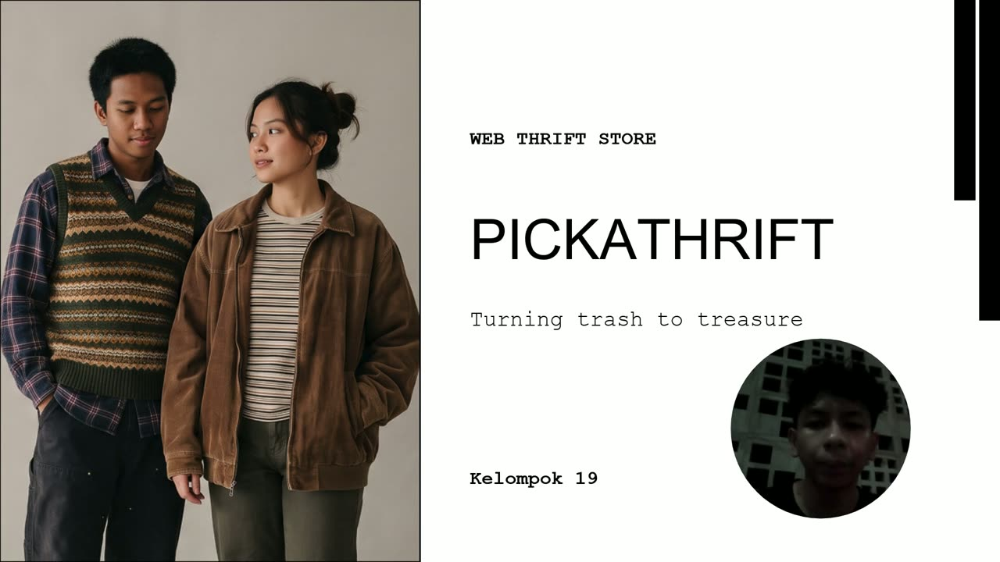
  </a>
</p>

<p align="center"><sub>▶ Klik gambar untuk menonton video presentasi (±10 menit).</sub></p>

---

## Live

| Bagian                     | Link                                                                                                    |
| -------------------------- | ------------------------------------------------------------------------------------------------------- |
| Aplikasi (Vercel)          | [pickathrift-web.vercel.app](https://pickathrift-web.vercel.app)                                        |
| API (Railway)              | [pickathriftbe-production.up.railway.app](https://pickathriftbe-production.up.railway.app/api/products) |
| Laporan dan dokumen proyek | [Google Drive](https://drive.google.com/drive/folders/18fWD-o-8HaH5uzsJtjpsghzn-5u93bpv?usp=sharing)    |
| Kontrak API                | [be/API.md](be/API.md)                                                                                  |
| Aturan pesanan             | [docs/aturan-pesanan.md](docs/aturan-pesanan.md)                                                        |

Pembayaran berjalan di **Midtrans Sandbox**. Tidak ada uang sungguhan yang berpindah;
VA dan QRIS dibayar lewat simulator sandbox Midtrans.

---

## Screenshot

Diambil dari aplikasi dengan data katalog contoh. Data pribadi pembeli pada layar Admin
sudah disamarkan.

### Beranda

<p align="center">
  <a href="docs/screenshots/beranda-penuh.jpg">
    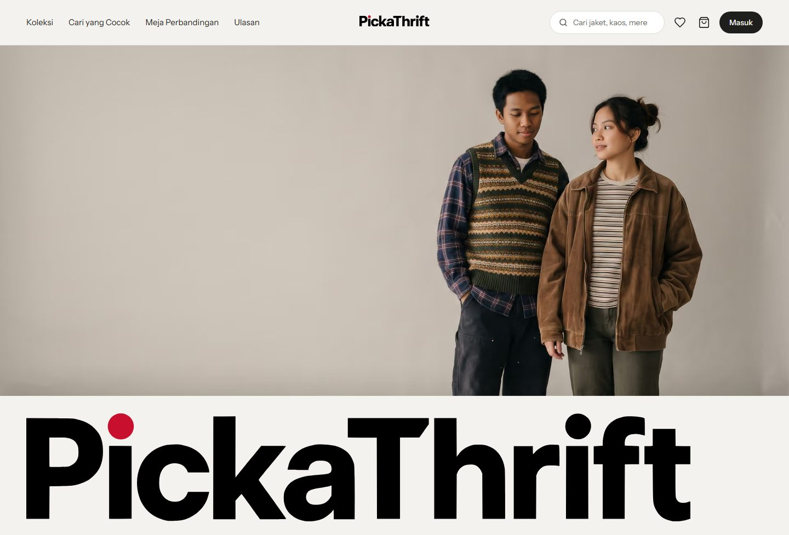
  </a>
</p>
<p align="center"><sub>Klik gambar untuk melihat beranda satu halaman penuh.</sub></p>

<table>
  <tr>
    <th width="50%">Katalog: filter kategori, ukuran, kondisi, dan harga</th>
    <th width="50%">Detail produk: ukuran dalam sentimeter</th>
  </tr>
  <tr>
    <td valign="top"><a href="docs/screenshots/katalog.jpg">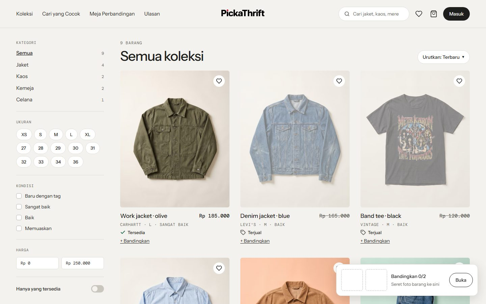</a></td>
    <td valign="top"><a href="docs/screenshots/produk.jpg">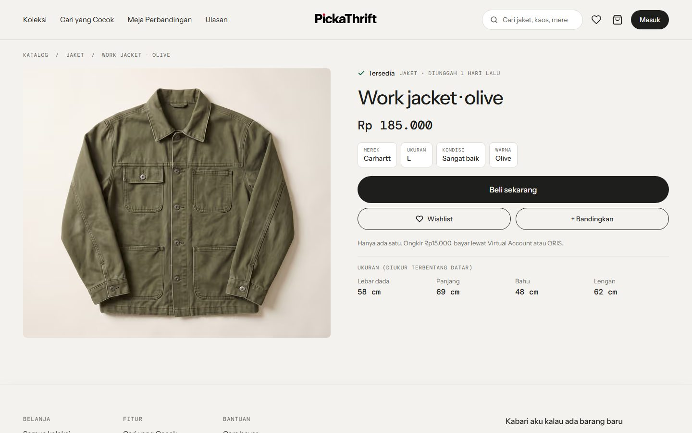</a></td>
  </tr>
  <tr>
    <th>Cari yang Cocok: hasil untuk kriteria Jaket</th>
    <th>Meja Perbandingan: dua jaket baris demi baris</th>
  </tr>
  <tr>
    <td valign="top"><a href="docs/screenshots/cari-yang-cocok-hasil.jpg">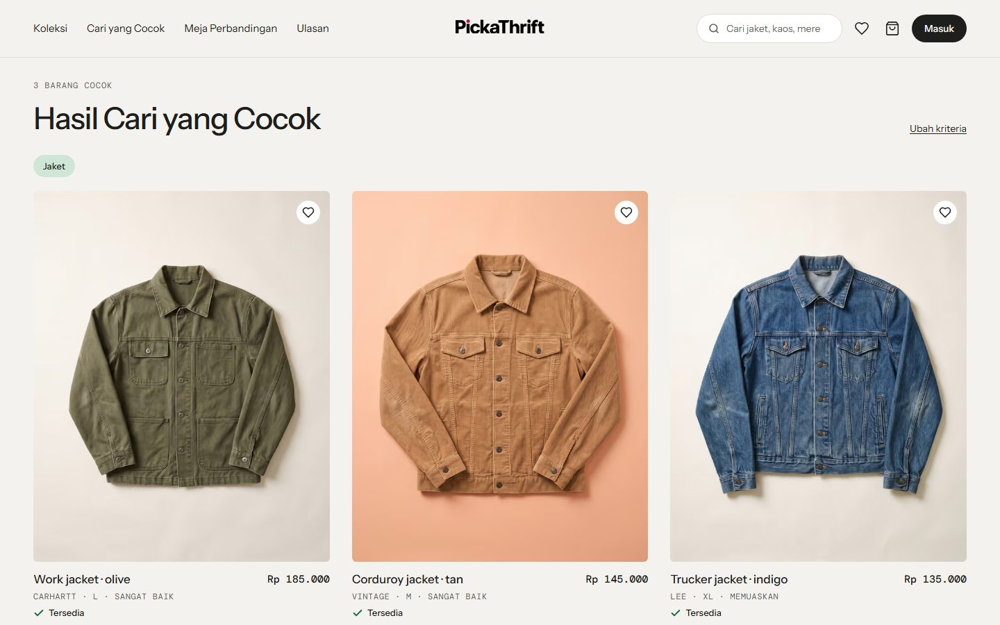</a></td>
    <td valign="top"><a href="docs/screenshots/meja-perbandingan.jpg">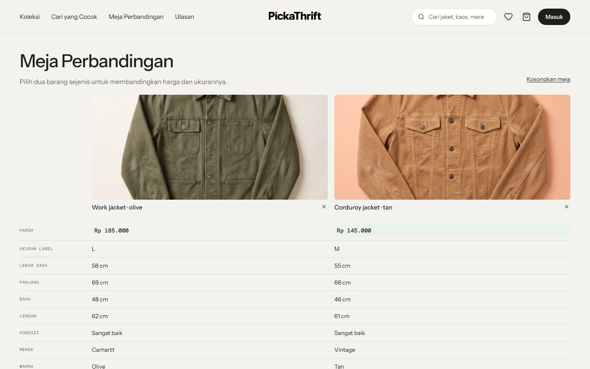</a></td>
  </tr>
  <tr>
    <th>Admin: kelola produk dan status stok</th>
    <th>Admin: tambah produk dengan pratinjau kartu katalog</th>
  </tr>
  <tr>
    <td valign="top"><a href="docs/screenshots/admin-produk.jpg">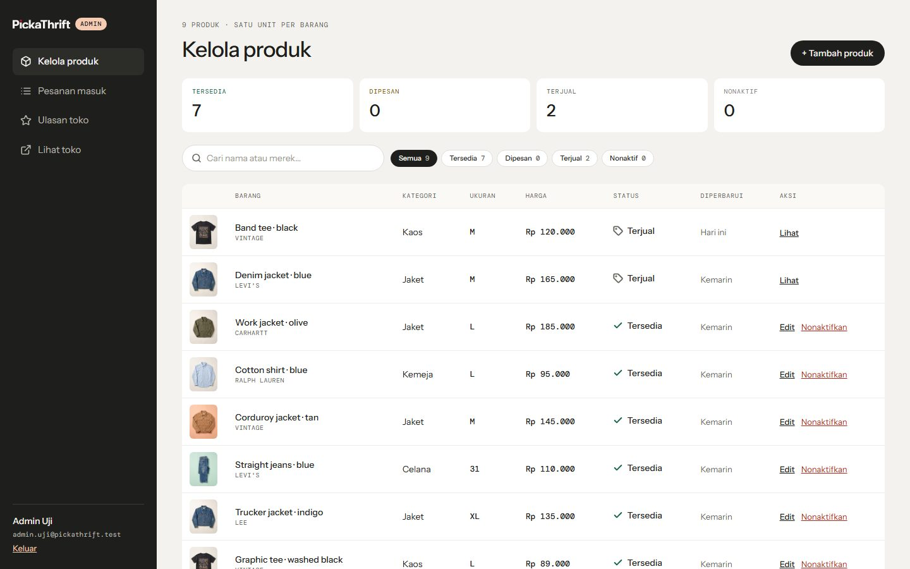</a></td>
    <td valign="top"><a href="docs/screenshots/admin-produk-baru.jpg">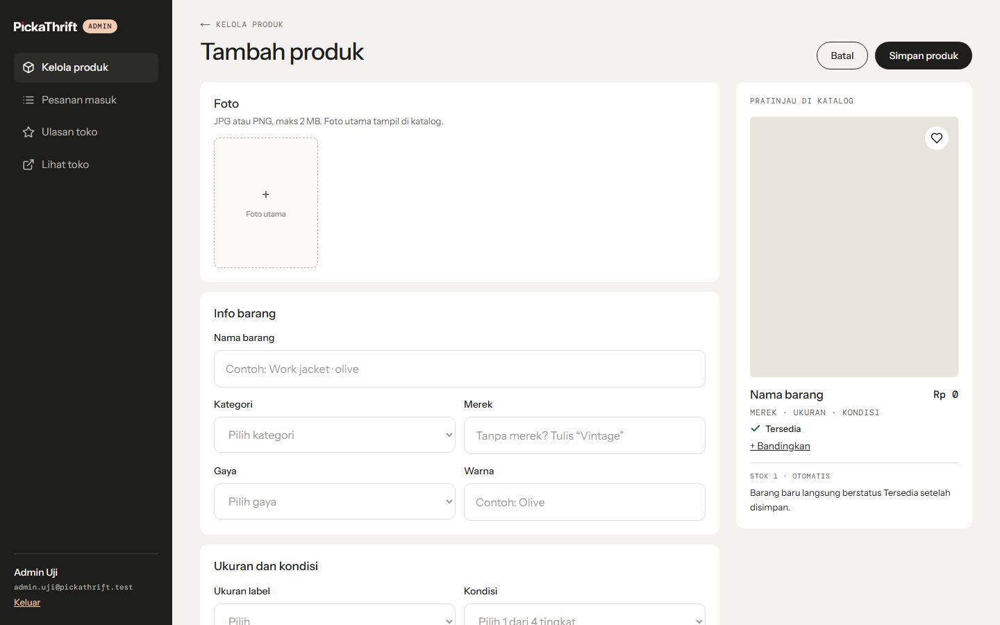</a></td>
  </tr>
  <tr>
    <th>Admin: pesanan masuk per status</th>
    <th>Admin: pesanan lunas via QRIS, siap dikirim</th>
  </tr>
  <tr>
    <td valign="top"><a href="docs/screenshots/admin-pesanan.jpg">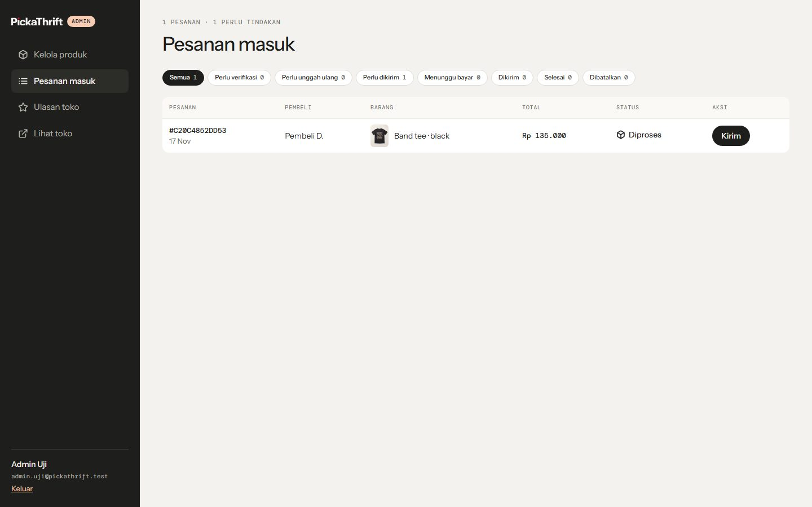</a></td>
    <td valign="top"><a href="docs/screenshots/admin-pesanan-detail.jpg">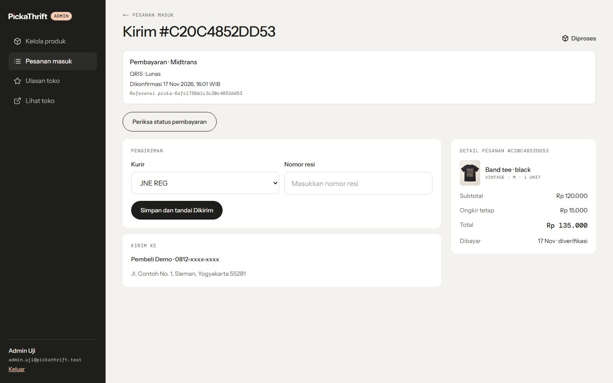</a></td>
  </tr>
</table>

### Ponsel

<table>
  <tr>
    <th width="33%">Beranda</th>
    <th width="33%">Katalog</th>
    <th width="33%">Detail produk</th>
  </tr>
  <tr>
    <td valign="top">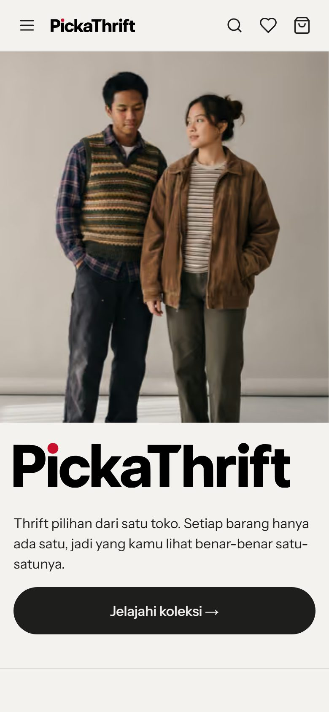</td>
    <td valign="top">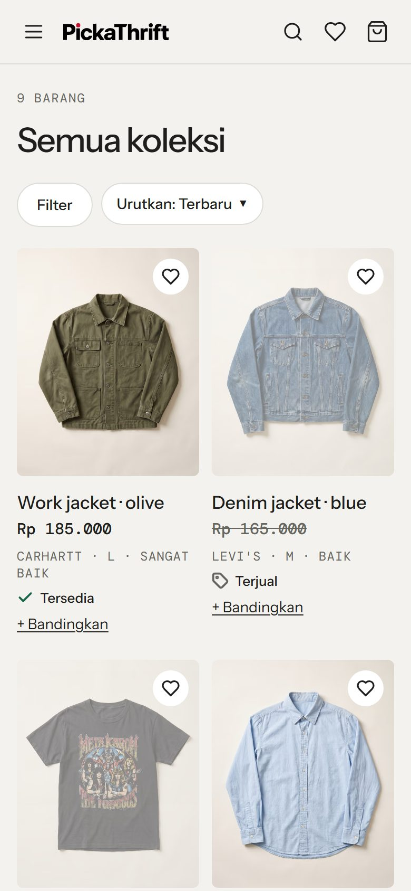</td>
    <td valign="top">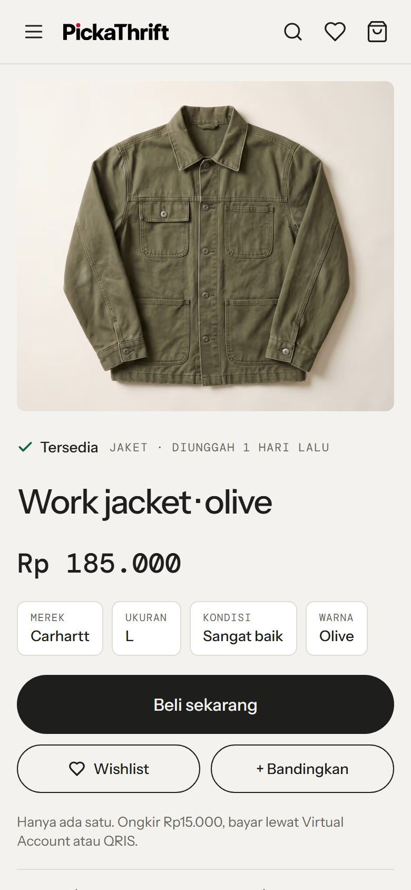</td>
  </tr>
</table>

---

## Fitur

| Fitur                  | Yang terjadi                                                                                                                                                         |
| ---------------------- | -------------------------------------------------------------------------------------------------------------------------------------------------------------------- |
| Katalog                | Pencarian, filter kategori, ukuran, kondisi, dan rentang harga, pengurutan, serta tombol "Muat lebih banyak". Barang terjual tetap tampil tapi pudar.                |
| Detail produk          | Merek, ukuran label, kondisi, warna, dan ukuran pakaian dalam sentimeter (lebar dada, panjang, bahu, lengan).                                                        |
| Cari yang Cocok        | Buyer memilih jenis, gaya, ukuran label, dan budget, lalu boleh mengisi ukuran baju yang sudah pas. Hasilnya diurutkan menurut selisih ukuran.                       |
| Meja Perbandingan      | Maksimal dua barang sejenis. Bisa ditambah lewat tombol atau dengan menyeret foto ke tray. Pilihan disimpan di browser dan tidak mengunci barang.                    |
| Wishlist               | Menyimpan barang per akun Buyer. Menyimpan tidak mengunci barang.                                                                                                    |
| Akun                   | Daftar dan masuk dengan email, atau Masuk dengan Google. Profil dan alamat pengiriman divalidasi di FE dan BE.                                                       |
| Checkout dan reservasi | "Beli sekarang" langsung mengunci satu-satunya unit secara atomik. Pembeli kedua mendapat layar "Keduluan" (409), bukan pembayaran ganda.                            |
| Pembayaran             | Midtrans Snap sandbox: Virtual Account bank dan QRIS. Status pesanan diperbarui lewat webhook bertanda tangan dan dicek ulang ke Midtrans.                           |
| Batas bayar            | 6 jam sejak pesanan dibuat, dengan hitung mundur di layar. Pesanan yang lewat batas dibatalkan dan barang kembali Tersedia.                                          |
| Pesanan Buyer          | Riwayat per status, detail, pembatalan sebelum bayar, dan konfirmasi barang diterima.                                                                                |
| Ulasan                 | Rating dan ulasan hanya untuk pesanan Selesai.                                                                                                                       |
| Admin                  | CRUD produk dengan foto, nonaktifkan barang, pesanan masuk per status, periksa status pembayaran, input kurir dan resi, verifikasi bukti transfer lama, ulasan toko. |
| Keamanan dasar         | JWT, peran Buyer/Admin di setiap endpoint, pembatasan percobaan login per IP, dan foto di bucket Supabase private.                                                   |

---

## Cara kerja

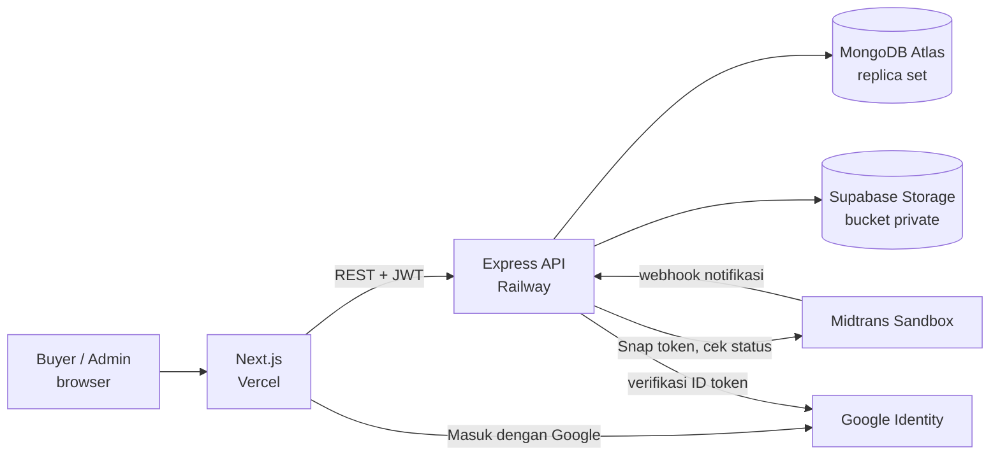

### Satu barang, satu pembeli

Setiap produk punya satu unit dengan status **Tersedia**, **Dipesan**, atau **Terjual**.
Pesanan dibuat di dalam transaksi MongoDB yang mengubah status produk dari Tersedia ke
Dipesan secara bersyarat. Jika dua pembeli menekan "Beli sekarang" bersamaan, hanya satu yang
berhasil. Yang lain mendapat `409` dan layar "Keduluan".

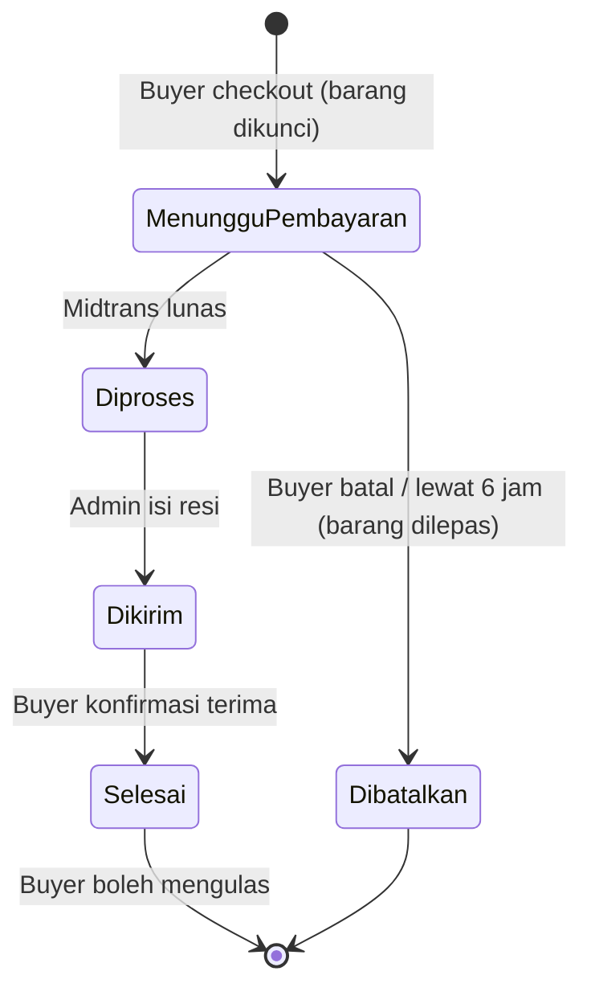

Aturan lengkap, termasuk alur bukti transfer manual untuk pesanan lama, ada di
[docs/aturan-pesanan.md](docs/aturan-pesanan.md).

---

## Tech stack

| Lapisan     | Teknologi                                                                       |
| ----------- | ------------------------------------------------------------------------------- |
| Frontend    | Next.js (App Router), React, TypeScript, Tailwind CSS 4                         |
| Backend     | Node.js 22, ExpressJS, Mongoose                                                 |
| Database    | MongoDB Atlas (replica set, untuk transaksi reservasi)                          |
| Penyimpanan | Supabase Storage, bucket private; foto disajikan lewat BE                       |
| Pembayaran  | Midtrans Snap Sandbox (VA dan QRIS) dengan webhook dan rekonsiliasi status      |
| Auth        | JWT aplikasi, bcrypt, Google Identity Services                                  |
| Pengujian   | Vitest (FE), `node:test` + MongoDB replica set sementara (BE), Playwright (E2E) |
| Kualitas    | ESLint, Prettier, TypeScript strict, satu pnpm workspace                        |
| Hosting     | Vercel (FE), Railway (BE)                                                       |
| Desain      | Figma                                                                           |

---

## Menjalankan lokal

### Prasyarat

- Node.js 22 atau lebih baru
- pnpm 12 (lihat `packageManager` di [package.json](package.json))
- MongoDB replica set atau MongoDB Atlas (dibutuhkan untuk transaksi reservasi)

### Langkah

```bash
pnpm install
```

Isi `be/.env` (minimal `MONGODB_URI` dan `JWT_SECRET`) dan `fe/.env.local`
(`NEXT_PUBLIC_API_URL=http://localhost:5000`). Daftar lengkap variabel ada di
[be/README.md](be/README.md) dan [docs/deployment.md](docs/deployment.md).

```bash
pnpm --filter @pickathrift/be dev
```

```bash
pnpm --filter @pickathrift/fe dev
```

Buka `http://localhost:3000`. Untuk membuat akun Admin, isi `ADMIN_NAME`, `ADMIN_EMAIL`, dan
`ADMIN_PASSWORD`, lalu jalankan `pnpm --filter @pickathrift/be admin:create`.

Panduan tambahan:

- [Login dengan Google](docs/login-google.md)
- [Integrasi auth FE dan BE](docs/auth-integration.md)
- [Deployment Vercel dan Railway](docs/deployment.md)

---

## Pengujian

Dari root repositori:

```bash
pnpm lint
```

```bash
pnpm typecheck
```

```bash
pnpm test
```

```bash
pnpm format:check
```

Tes BE menjalankan request HTTP sungguhan terhadap MongoDB replica set sementara. Ini
mencakup reservasi atomik, pembatasan login, webhook dan rekonsiliasi Midtrans, serta
penyimpanan Supabase. Tes E2E Playwright ada di [fe/e2e](fe/e2e):

```bash
pnpm --filter @pickathrift/fe test:e2e
```

---

## Struktur repositori

```text
pickathrift/
├── fe/                  # Next.js App Router, TypeScript, Tailwind CSS 4
│   ├── src/app/         # rute: /katalog, /produk/[id], /cari-yang-cocok, /meja-perbandingan, /admin, ...
│   ├── src/modules/     # fitur per domain: catalog, checkout, orders, admin, match, compare, ...
│   └── e2e/             # tes Playwright
├── be/                  # ExpressJS + MongoDB
│   ├── routes/          # endpoint REST
│   ├── services/        # pesanan, pembayaran, Midtrans, penyimpanan
│   ├── models/          # skema Mongoose
│   ├── test/            # tes HTTP dengan replica set sementara
│   └── API.md           # kontrak API
├── docs/                # aturan pesanan, deployment, panduan login, screenshot
├── package.json         # skrip workspace: dev, build, lint, typecheck, test, format
└── pnpm-workspace.yaml
```

Penjelasan lebih rinci ada di [fe/README.md](fe/README.md) dan [be/README.md](be/README.md).

---

## Batasan

- Pembayaran hanya **Midtrans Sandbox**. Transaksi uang sungguhan belum didukung.
- Ongkir tetap Rp15.000. Belum ada kalkulasi ongkir per kurir atau per alamat.
- Satu barang per pesanan. Keranjang dan Blindbox belum diimplementasikan.
- Newsletter di footer belum terhubung ke layanan email.
- Pembatasan percobaan login disimpan di memori satu proses. Jika BE dijalankan lebih dari
  satu instance, pembatasan perlu dipindah ke store bersama.

---

## Tim

Kelompok 19:

| Nama                          | NIM                |
| ----------------------------- | ------------------ |
| Annora Farah Aprilla Setyawan | 24/538937/TK/59766 |
| Harum Satiti Astyanti         | 24/543492/TK/60398 |
| Muhammad Farrel Al Ghazy      | 24/540589/TK/60022 |
| Rasyadwa Arsya Irnantyanto    | 24/534714/TK/59283 |

Rasyadwa Arsya Irnantyanto menjadi Project Manager sekaligus mendukung pekerjaan frontend
dan backend. Pembagian peran tiga anggota lainnya belum tercatat secara terverifikasi dalam
repositori atau laporan Milestone 1.
